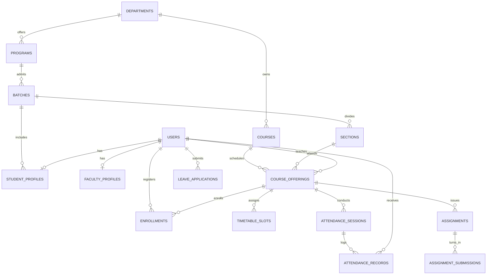

# DBS Global University Portal (DBS-Camu Next)
## Technical Architecture & Database Design Specification

### 1. Executive Summary
This project is an in-house, high-performance academic ERP and campus portal for **DBS Global University (Dehradun)** designed to replace the legacy **MyCamu** platform. It addresses the critical drawbacks of MyCamu:
- Eliminates 8–15 second load times with modern server-side and client caching.
- Solves rigid attendance auditing by introducing a **Smart 75% Attendance Simulator & Bunk Calculator** for students and a **1-Click Attendance Roll Call** for faculty.
- Streamlines the On-Duty (OD) approval workflow for university hackathons, fests, and sports events.
- Provides a mobile-first PWA experience without App Store installation barriers.

---

### 2. Core Entity Relationship & Schema Map

---

### 3. Database Files Reference
- **PostgreSQL DDL & Index Script:** [`docs/database/schema.sql`](file:///Users/harsh/Library/CloudStorage/GoogleDrive-harendrapratap5828@gmail.com/My%20Drive/Tahoe/Downloads/camu/docs/database/schema.sql)
- **Prisma ORM Schema:** [`docs/database/schema.prisma`](file:///Users/harsh/Library/CloudStorage/GoogleDrive-harendrapratap5828@gmail.com/My%20Drive/Tahoe/Downloads/camu/docs/database/schema.prisma)

---

### 4. Mathematical Attendance Logic
The portal implements the real-time calculation rule required by DBS Global University and AICTE:

$$\text{Attendance \%} = \frac{\text{Attended Classes} + \text{Approved On-Duty (OD)}}{\text{Total Conducted Classes}} \times 100$$

#### Debarment Buffer Formulas:
1. **Safe Misses ($M$):** Max future classes a student can skip while keeping $\% \ge 75\%$:
   $$M = \left\lfloor \frac{\text{Attended} + \text{OD}}{0.75} \right\rfloor - \text{Conducted}$$
2. **Deficit Recovery ($R$):** Consecutive classes a student must attend to cross $75\%$:
   $$R = \left\lceil \frac{0.75 \times \text{Conducted} - (\text{Attended} + \text{OD})}{0.25} \right\rceil$$

---

### 5. Running and Extending the App
- **Local Dev Server:** `http://localhost:5173/`
- **Build Production Bundle:** `npm run build`
- **Role Switching:** Click the **Viewing As: [Student / Faculty]** pill at the top-right to test both the Student experience and the 1-Click Faculty attendance roll call.
